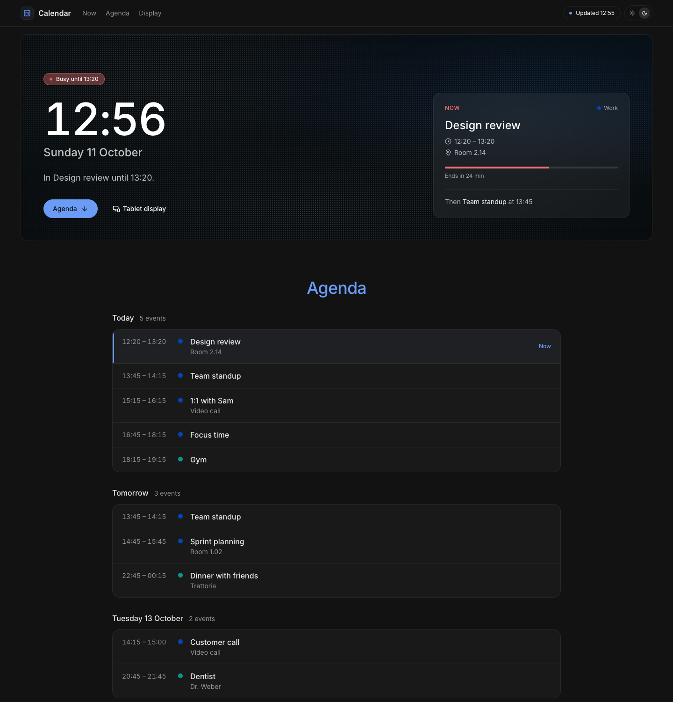
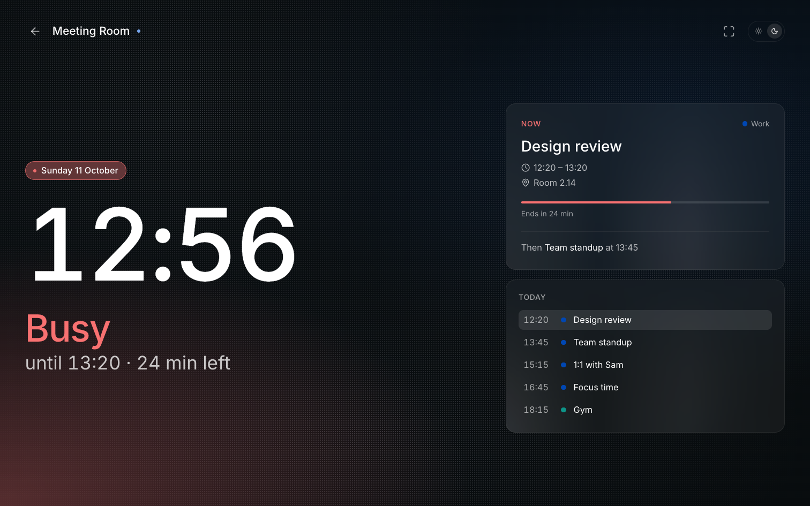
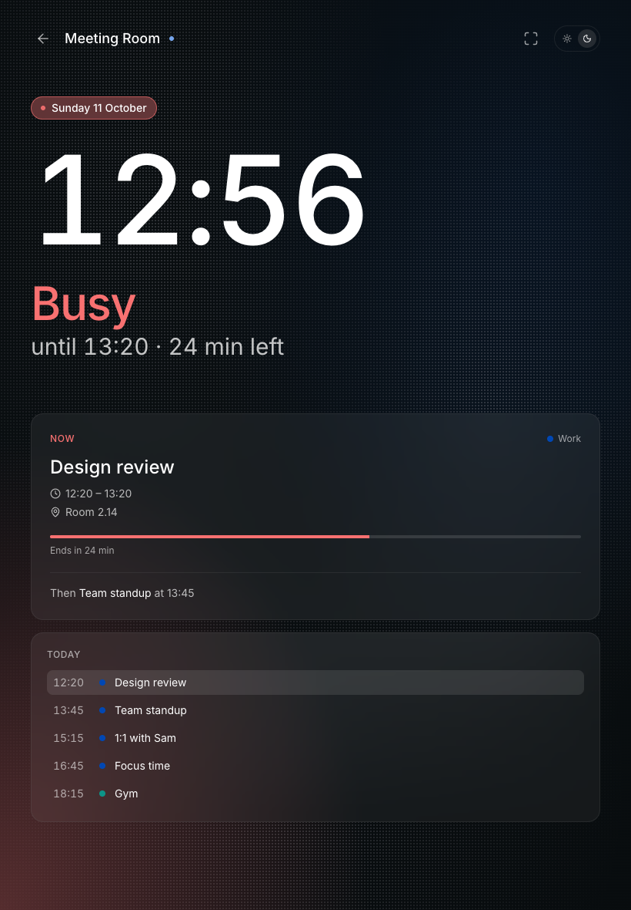

# CalDAV Dashboard

A single-user calendar display for any CalDAV server, inspired by [spacepad.io](https://spacepad.io). Shows whether you are free or busy, the event that is on now or next, and the agenda for the coming days. A full-screen view at `/display` turns a spare tablet into a room display.

## Screenshots

**Dashboard:** status and the current event up front, then the agenda for the coming days.



**Tablet display** at `/display`: full screen, the state colour glows up from the corner.





The screenshots use demo calendars.

## Features

- Works with any CalDAV server (Nextcloud, Radicale, Baïkal, iCloud, Fastmail), and with plain ICS feeds
- Several calendars at once, e.g. private and work, each with a name and its colour from the server
- Nextcloud subscriptions work too: the dashboard reads the feed the subscription mirrors
- Status like a room display: free, starting soon, busy, with back-to-back meetings counted as one block
- The next event highlighted, with a countdown and a progress bar while it runs
- Recurring events and their exceptions, all-day and multi-day events, cancelled and "free" events handled
- Refreshes every five minutes and when the tab comes back; keeps the last data if the server is unreachable
- `/display` for tablets: state colour across the screen, keeps the screen awake, full-screen button
- Optional password, optional hidden titles ("Busy" instead of the event name)
- Responsive, light and dark theme

## Stack

| Layer | Tech |
|---|---|
| Framework | Next.js 16 (App Router, React 19, React Compiler), TypeScript |
| Styling | Tailwind CSS v4 with the fumadocs neutral palette |
| Calendar | CalDAV `REPORT calendar-query` from the server, parsed and expanded with [ical.js](https://github.com/kewisch/ical.js) |
| Runtime | Node.js on Chainguard (Wolfi), standalone output, port `8080`, no shell |

The credentials never reach the browser. The server fetches the calendars, caches them for a minute and serves `/api/events`.

## Configuration

| Variable | Purpose |
|---|---|
| `CALDAV_URL` | One or more calendars, comma separated, optionally named: `Private=https://...,Work=https://...`. A CalDAV collection like `https://cloud.example.com/remote.php/dav/calendars/<user>/<calendar>/`, a Nextcloud subscription, or an ICS feed (`?export` share, `.ics` URL) |
| `CALDAV_USER`, `CALDAV_PASSWORD` | Basic auth for the calendars. For Nextcloud, use an app password. Only sent to the hosts of CalDAV collections, never to feeds elsewhere |
| `ROOM_NAME` | Title on `/display`, default `Calendar` |
| `TZ` | Time zone, default `Europe/Berlin` |
| `LOCALE` | Date and time format, default `en-GB` |
| `DAYS` | How far ahead the agenda goes, default `7`, max `31` |
| `REFRESH_MINUTES` | Default `5` |
| `SOON_MINUTES` | "Starting soon" this many minutes before an event, default `10` |
| `HIDE_TITLES` | `true` shows "Busy" instead of event titles |
| `DASH_PASSWORD`, `DASH_USER` | Optional basic auth for everything but `/api/health` |

## Run it

```bash
cp .env.example .env   # fill in CALDAV_URL, CALDAV_USER, CALDAV_PASSWORD
docker compose up -d
# http://localhost:3000, tablet view at http://localhost:3000/display
```

```yaml
# or set the variables in docker-compose.yml
environment:
  - CALDAV_URL=https://your-caldav-server.com/path/to/calendar/
  - CALDAV_USER=your_username
  - CALDAV_PASSWORD=your_password
```

## Development

```bash
cp .env.example .env.local
npm install
npm run dev
```

## Deploy

The image listens on port `8080` and has no shell, so the compose healthcheck uses node. Put it behind a reverse proxy with TLS, and set `DASH_PASSWORD` if the dashboard is reachable from the internet, since it shows your calendar to anyone who opens it.

Nextcloud can be set to only accept CalDAV from inside the network. In that case run the container there, or use a public share with `?export` as `CALDAV_URL`.

## CalDAV troubleshooting

- **401**: wrong user or password. Nextcloud with 2FA needs an app password.
- **403 / 404 on REPORT**: the URL is the calendar home, not a calendar. Use the collection URL, the one ending in the calendar name.
- **No events but no error**: check `TZ`, and that the events fall within `DAYS`.
- **Nextcloud subscription is empty**: Nextcloud does not serve subscribed events over CalDAV, so the dashboard fetches the subscription's source URL itself. That URL has to be reachable from the container.
